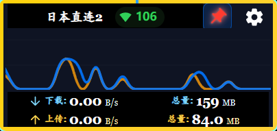
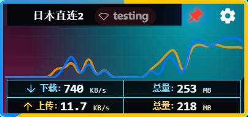
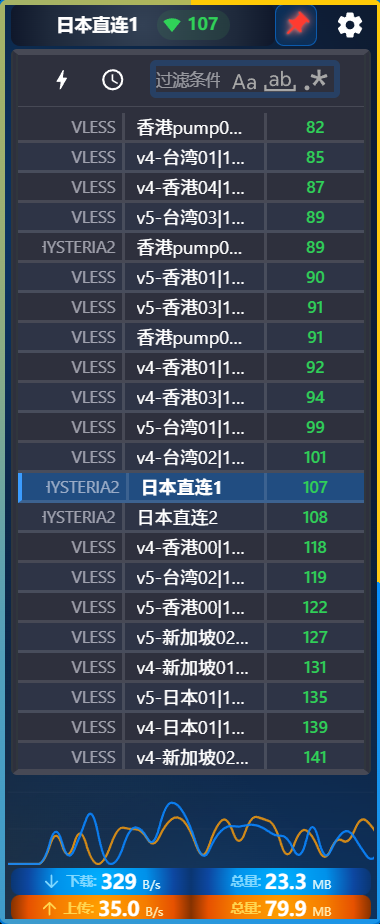
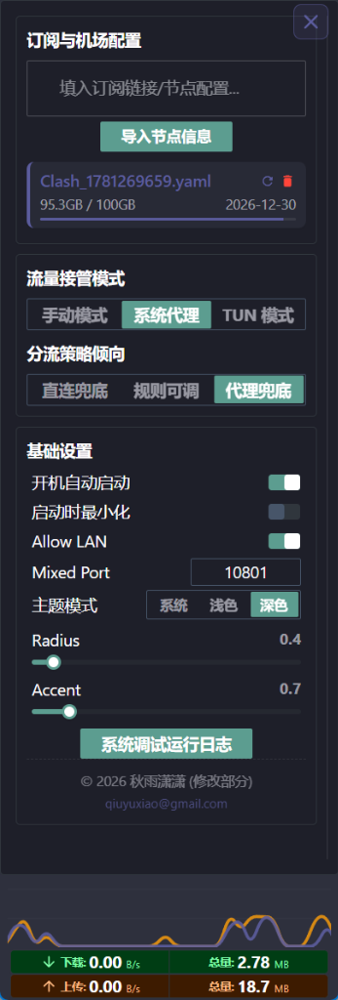
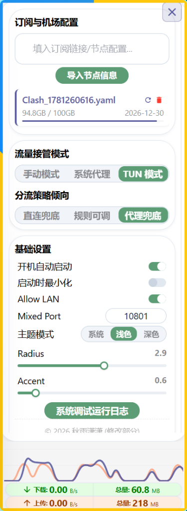
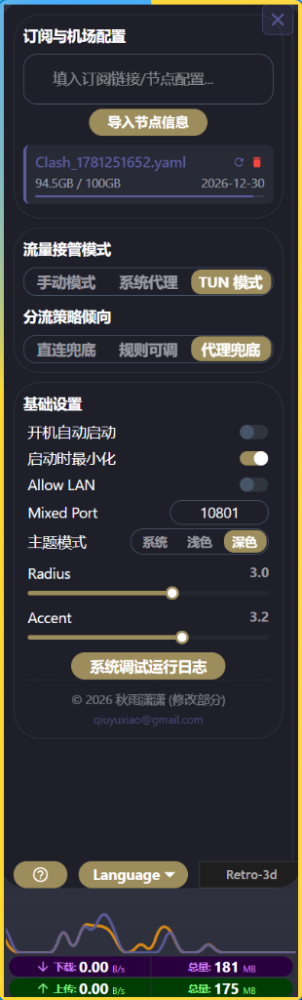
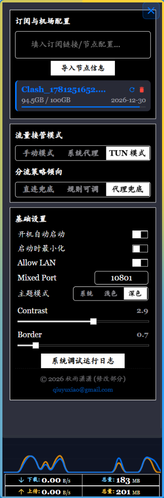
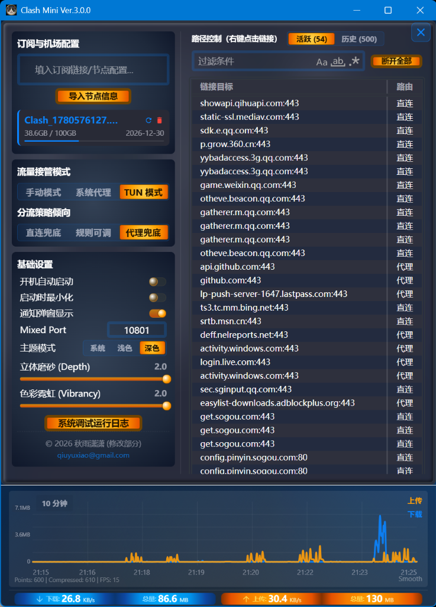
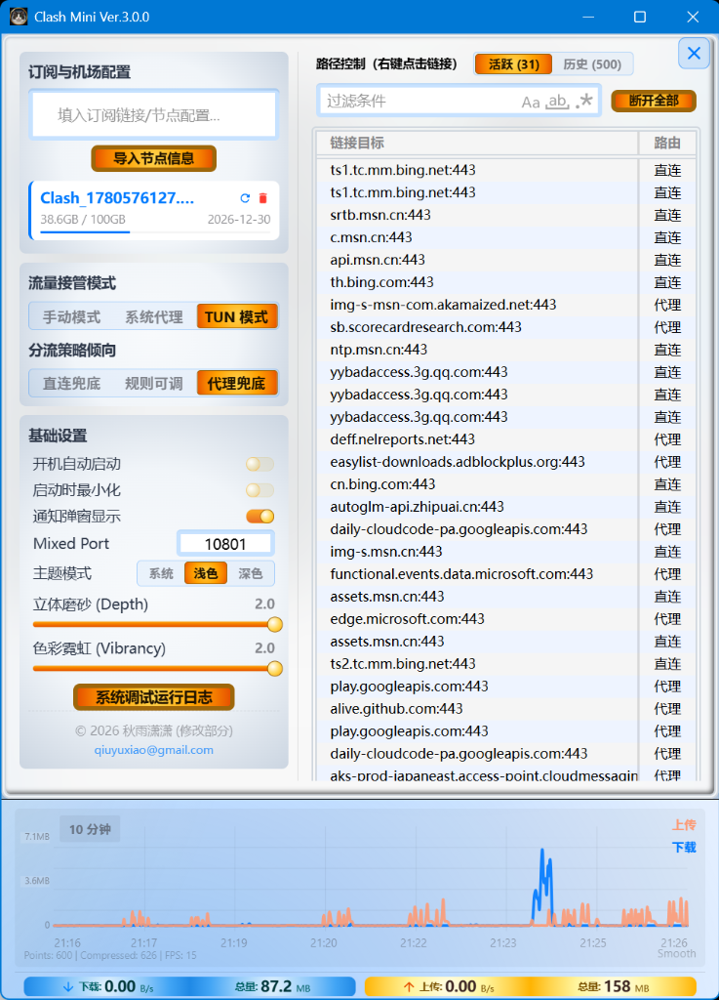
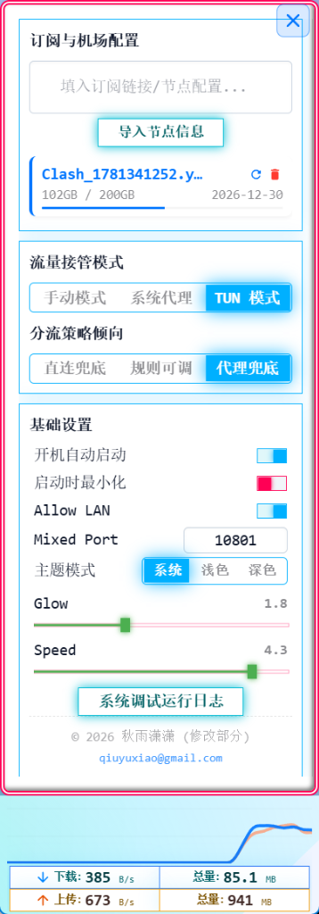

# Clash Mini

Clash Mini is a customized enhancement of **Clash Verge**, optimized for tailored workflows, enhanced 3D visual styles, and performance.

---

## Quick Start Guide

> **Core Value**: Continuity-first (zero-drop connection stability) — minimalist, zero-threshold, out-of-the-box, the preferred choice for beginners.

### Getting Started
Click the [Gear] button in the upper right corner of Clash Mini, paste your subscription link/node configuration (supporting 19 protocols) into the "Subscription Link/Node Config" field, click [Import Node Info], and wait for the proxy node to be activated.

### Client Configuration
* **Browsers**: You can start browsing the web directly after importing the nodes.
* **Other Client Apps**: Most apps can access the internet directly. For the few that cannot, you can manually set their proxy address to `127.0.0.1` and port to `10801`.
* **Global Proxy**: If the software lacks manual proxy configuration options, please enable Clash Mini's **TUN Mode**.

> [!NOTE]
> **What is [TUN Mode]?**
> It creates a system virtual network adapter to fully hijack all network traffic. It is suitable for region-locked games, command-line terminals, and other software that ignores system proxy settings.
> *Note: TUN mode consumes more system resources and is prone to conflicts. Unless you have the specific needs mentioned above, there is no need to enable it; the default settings are sufficient.*

### Key Features
* **[Continuity-First & Smart Self-Healing]**: Once a usable exit node is active, Clash Mini never switches nodes in the background merely to chase lower latency, keeping active long-lived connections (AI sessions, terminals, downloads, calls) uninterrupted. Only when no valid exit exists on initial import or when the current node is confirmed dead (passive traffic liveness + multi-stage hysteresis + dual-URL verification) does it seamlessly hot-failover without dropping existing streams, while filtering out fake/ad nodes.
* **[On-Demand Speed Selection & Region Filtering]**: Press `F1` / `F4` whenever you want to benchmark and pick the fastest node manually, or type inclusion/exclusion keywords in the filter bar (e.g. `-HK` / `-香港`, `JP|SG`) to test and switch strictly within the filtered subset to bypass regional restrictions.
* **[Rule Updates]**: Integrates popular rule sets and GeoIP databases, keeping them synced and updated automatically.
* **[Mini-Monitoring]**: Shrink the window to its minimum size to transform the application into a compact traffic meter.
* **[Right-Click Routing (Advanced Users Only)]**: Right-click any link in the [Path Control] list to direct-connect, proxy, or reject, manually generating highest-priority routing rules (requires maximizing the application window to use this feature).

---

## 快速开始指南

> **核心价值**: 优先保证连接不断流——极简、零门槛、开箱即用，新手首选。

### 开始使用
点击 Clash Mini 右上角的 [齿轮] 按钮，将您的订阅链接/节点配置（支持19种协议）粘贴到"订阅链接/节点配置"字段中，点击 [导入节点信息]，等待代理节点激活即可。

### 客户端配置
* **浏览器**: 导入节点后即可直接浏览网页。
* **其他客户端应用**: 大多数应用可直接上网。少数无法直接上网的应用，可手动设置代理地址为 `127.0.0.1`，端口为 `10801`。
* **全局代理**: 如果软件没有手动代理配置选项，请启用 Clash Mini 的 **TUN 模式**。

> [!NOTE]
> **什么是 [TUN 模式]？**
> 创建系统虚拟网络适配器，全面劫持所有网络流量。适用于锁区游戏、命令行终端等无视系统代理设置的软件。
> *注意：TUN 模式会消耗更多系统资源，容易产生冲突。除非您有上述特定需求，否则无需启用，默认设置已足够。*

### 核心功能
* **[不断流优先与智能自愈]**: 一旦当前出口节点可用，后台守护绝不会仅因“别的节点延迟更低”而切点或打断进行中的长连接（AI 对话、终端会话、大文件下载、音视频通话等）。仅在首次导入尚无可用节点，或结合被动流量证活 + 多阶段防抖迟滞 + 双测速源核验确证当前节点真正失效时，才触发无感热切换自愈并拦截广告假节点，全程不清理存量连接。
* **[按需测速优选与地域过滤]**: 当你需要主动寻找更快节点时，可随时按 `F1`（全列表）或 `F4`（当前过滤子集）手动测速择优；在过滤栏输入包含或排除关键词（如 `-香港`、`日本|新加坡`）即可严格针对可见子集重选与切换，规避软件的地域限制。
* **[规则更新]**: 集成流行规则集和 GeoIP 数据库，自动同步更新。
* **[迷你监控]**: 将窗口缩小至最小尺寸，应用变为小巧的流量监控器。
* **[右键路由（高级用户）]**: 在 [路径控制] 列表中右键任意链接，可直连、代理或拒绝，手动生成最高优先级路由规则（需最大化应用窗口才能使用此功能）。

---

## Visual Showcase

### 1. Micro-Monitoring Mode (流量监控模式)
* **Standard Style (标准风格)**:
   
  
* **Retro-3D Style (复古拟物风格)**:
   
  

### 2. Node List in Narrow Layout (窄窗口模式 节点列表)

  

### 3. Settings Panels (窄窗口模式 设定选项)
* **Dark Theme (深色主题 - 专家级选项)**:
   
  
* **Light Theme (浅色主题 - 小白设定选项)**:
   
  
* **Retro-3D Theme (复古拟物主题)**:
   
  
* **Monochrome Theme (黑白极简主题)**:
   
  

### 4. Expert Mode Layouts (宽窗口专家模式)
* **Dark Theme (深色主题)**:
   
  
* **Light Theme (浅色主题)**:
   
  

### 5. Update Dropdown (更新与帮助菜单)

  

---

## Copyright and Licensing

- **Upstream Project**: Clash Mini is a derivative work based on [Clash Verge](https://github.com/clash-verge-rev/clash-verge-rev). We respect and acknowledge the copyright of the original authors of Clash Verge.
- **Custom Portions**: Copyright (c) 2026 秋雨潇潇 <qiuyuxiao@gmail.com>. All rights reserved. (Only applies to custom modifications, style adaptations, and visual layouts introduced in this custom version).
- **License**: The entire project is licensed under the GNU General Public License v3.0 (GPL-3.0-only). See [LICENSE](LICENSE) for details.

## Development and Contributions

See [CONTRIBUTING.md](CONTRIBUTING.md) for details on setting up the environment and contributing code.
